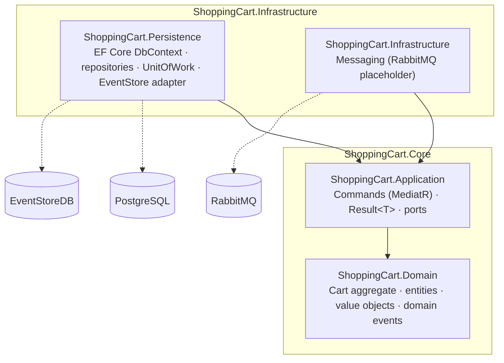
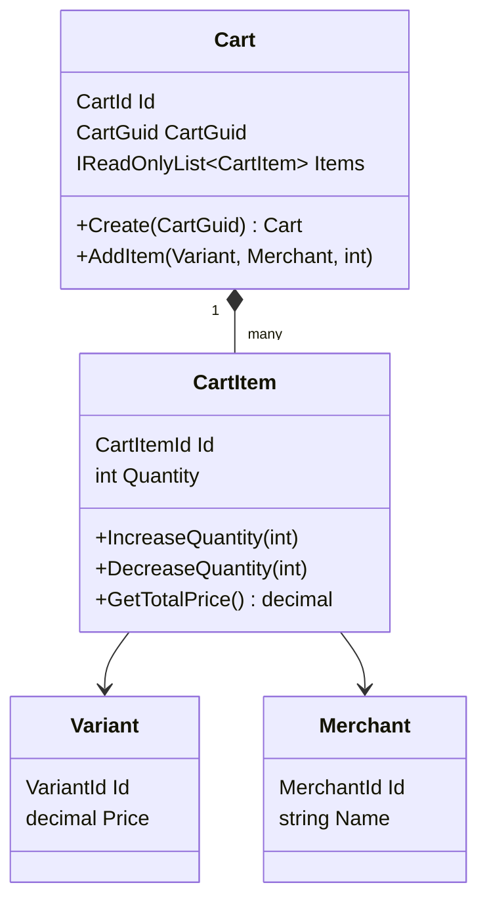

# ShoppingCartProject

The core of a shopping cart microservice in .NET 9. It is built with Clean Architecture and DDD tactical patterns (aggregates, strongly typed IDs, domain events), with persistence on EF Core and PostgreSQL.


## Overview

`ShoppingCartService` models a multi-merchant shopping cart. A **Cart** aggregate holds **CartItems**. Each item references a product **Variant** (with its price) and the **Merchant** that sells it. Adding the same variant from the same merchant again increases the quantity instead of creating a new line. Every state change raises a domain event.

> **Current state:** this is the domain, application and persistence core of the service. There is **no API/host project yet**, so the service cannot be started or called over HTTP. The single implemented use case is **create cart** (`CreateCartCommand`). The event store and message bus integrations are stubs (see [Known limitations / roadmap](#known-limitations--roadmap)).

What is implemented:

- **Domain:** the `Cart` aggregate root, `CartItem`, `Variant` and `Merchant` entities, strongly typed IDs (`CartId`, `CartItemId`, `VariantId`, `MerchantId`, `CartGuid`), guard-clause validation (`DomainValidation`), and the domain events `CartCreatedEvent`, `CartItemAddedEvent` and `CartItemUpdatedEvent`.
- **Application:** CQRS command abstractions on top of MediatR (`ICommand<T>`, `ICommandHandler<TCommand, T>`), the `CreateCartCommand` handler, a `Result<T>` envelope with optional pagination, and ports (`ICartWriteRepository`, `IUnitOfWork`, `IEventStore`, `IMessageBus`).
- **Persistence:** `ShoppingCartDbContext` with EF Core mappings for PostgreSQL, generic `ReadRepository` / `WriteRepository`, a `UnitOfWork` that dispatches domain events after `SaveChanges`, a reflection-based `DomainEventDispatcher`, and an `EventStore` adapter (EventStoreDB, legacy TCP client).
- **Infrastructure:** a `RabbitMqMessageBus` placeholder that implements `IMessageBus` but throws `NotImplementedException`.

## Architecture

Project references as they exist in the solution:



Dependencies point inward. The Domain has no dependencies. The Application layer defines the ports (`ICartWriteRepository`, `IEventStore`, `IMessageBus`, `IUnitOfWork`), and the outer projects implement them.

Domain model:



## Tech stack

| Concern | Choice |
|---|---|
| Runtime | .NET 9 (`net9.0`), C# with nullable reference types |
| CQRS / mediator | MediatR 12.4 |
| ORM / database | EF Core 9, Npgsql (PostgreSQL) |
| Event store | EventStoreDB via `EventStore.Client` 22 (legacy TCP client, `EventStore.ClientAPI`) |
| Messaging | RabbitMQ (interface only, not implemented) |

## Project structure

```text
ShoppingCartProject.sln
src/services/ShoppingCartService/
├── ShoppingCart.Core/
│   ├── ShoppingCart.Domain/
│   │   ├── Common/                 # Entity<T>, Aggregate<TId>, IDomainEvent, repository contracts
│   │   ├── Exceptions/             # DomainException
│   │   ├── Validations/            # DomainValidation guard clauses
│   │   └── ShoppingCart/
│   │       ├── Aggregates/         # Cart
│   │       ├── Entities/           # CartItem, Variant, Merchant
│   │       ├── Events/             # CartCreated / CartItemAdded / CartItemUpdated
│   │       ├── Exceptions/         # CartException
│   │       └── ValueObjects/       # CartId, CartGuid, CartItemId, VariantId, MerchantId
│   └── ShoppingCart.Application/
│       ├── Cart/Commands/          # CreateCartCommand + handler, ICommand / ICommandHandler
│       ├── Cart/Repositories/      # ICartWriteRepository
│       ├── CartItem/Repositories/  # ICartItemWriteRepository
│       └── Common/                 # Events, Messaging, Persistence ports, Result<T>, Pagination
└── ShoppingCart.Infrastructure/
    ├── ShoppingCart.Persistence/
    │   ├── Cart/Repositories/      # CartWriteRepository
    │   ├── Common/Data/            # ShoppingCartDbContext, UnitOfWork, EventStore, SaveChanges interceptor
    │   ├── Common/Events/          # DomainEventDispatcher
    │   ├── Common/Repositories/    # Generic Read/Write repositories
    │   └── DependencyInjection.cs  # AddPersistence / AddInfrastructure
    └── ShoppingCart.Infrastructure/
        └── Messaging/              # RabbitMqMessageBus (placeholder)
```

## Getting started

### Prerequisites

- [.NET 9 SDK](https://dotnet.microsoft.com/download/dotnet/9.0)
- Docker (only to try the persistence layer against a real PostgreSQL)

### Build

```bash
git clone https://github.com/gokhanertogan/ShoppingCartProject.git
cd ShoppingCartProject
dotnet build ShoppingCartProject.sln
```

### Wiring the persistence layer into a host

There is no host project yet. A future API or worker would register the persistence layer like this:

```bash
docker run -d --name shoppingcart-db -e POSTGRES_PASSWORD=postgres -p 5432:5432 postgres:16-alpine
```

```jsonc
// appsettings.json of the host
{
  "ConnectionStrings": {
    "ShoppingCartDb": "Host=localhost;Port=5432;Database=shoppingcart;Username=postgres;Password=postgres"
  }
}
```

```csharp
builder.Services.AddPersistence(builder.Configuration);
// Required: AddPersistence does not register an IEventStore implementation yet,
// but the SaveChanges interceptor depends on it.
builder.Services.AddScoped<IEventStore, /* your implementation */>();
```

`AddPersistence` reads the `ShoppingCartDb` connection string and registers `ShoppingCartDbContext` and `ICartWriteRepository`. There are no EF migrations yet, so create the schema with `dbContext.Database.EnsureCreated()` or add migrations first.

The create-cart flow has been checked end to end against PostgreSQL 16 this way (create, merge duplicate lines, reject a non-positive quantity with `400`).

### Sample requests

None yet: the service has no HTTP endpoints. The command that a future `POST /carts` endpoint would send through MediatR looks like this:

```csharp
var command = new CreateCartCommand
{
    CartGuid = Guid.NewGuid(),
    Items =
    [
        new CartItemRequest(
            new VariantItemRequest(variantId, Price: 10.50m),
            new MerchantItemRequest(merchantId, Name: "Acme"),
            Quantity: 2)
    ]
};

Result<Cart> result = await mediator.Send(command);
// 201 + cart on success, 400 + message for domain rule violations, 500 otherwise
```

## Design notes and trade-offs

- **Strongly typed IDs.** `CartId`, `CartItemId`, `VariantId` and `MerchantId` wrap `Guid` and reject `Guid.Empty`, so IDs of different entities cannot be swapped by accident. EF Core maps them with value converters.
- **Cart lines snapshot the variant and merchant.** `Variant` (price) and `Merchant` (name) are mapped as owned types of `CartItem`, so each line keeps the price and merchant name from the moment it was added, independent of the catalog. Two carts can contain the same variant without sharing rows.
- **Behavior lives in the aggregate.** Quantity rules and the merge of duplicate lines are enforced in `Cart.AddItem`, not in the handler. Rule violations raise `DomainException`, which the handler turns into a `400` result.
- **Domain events are collected, then dispatched after commit.** Aggregates buffer events (`AddDomainEvent` / `ClearDomainEvents`). `UnitOfWork` publishes them through `DomainEventDispatcher` after `SaveChangesAsync` succeeds, so handlers never see uncommitted state.
- **Separate read and write repositories.** The write side is exposed per aggregate (`ICartWriteRepository`), and the generic read repository supports no-tracking and paginated queries.
- **MediatR is pinned to 12.x**, the last version under the Apache 2.0 license.

## Known limitations / roadmap

- [ ] **API host:** add an ASP.NET Core project with cart endpoints (create cart, add/update/remove item, get cart).
- [ ] **More use cases:** only `CreateCartCommand` exists. There are no queries, and no handlers for item update or removal.
- [ ] **Event store:** `IEventStore` is not registered in DI, but `CustomSaveChangesInterceptor` depends on it, so resolving `ShoppingCartDbContext` fails until a host registers one. The interceptor also queries `IAggregate<object>` entries, which never match a concrete aggregate, so no events reach the store yet. Events are serialised through the `IDomainEvent` interface, which loses their payload and cannot be deserialised. A concrete serialisation strategy is needed. `EventStore.Client` 22 is the deprecated TCP client; the gRPC client is its replacement.
- [ ] **Unit of work:** `UnitOfWork` and `DomainEventDispatcher` are not registered by `AddPersistence` yet, and `CreateCartCommand` saves through `ICartWriteRepository.SaveAsync`. Domain events raised by the create-cart flow are therefore not dispatched today.
- [ ] **Messaging:** `RabbitMqMessageBus` is a placeholder, and integration events (`CartCreatedIntegrationEvent`) are commented out.
- [ ] **`IDomainEvent` defaults:** `EventId` and `OccurredOn` are computed on every read (`Guid.NewGuid()`, `DateTime.Now`) instead of being captured once when the event is raised.
- [ ] **EF Core migrations** and **tests**: neither exists yet.
